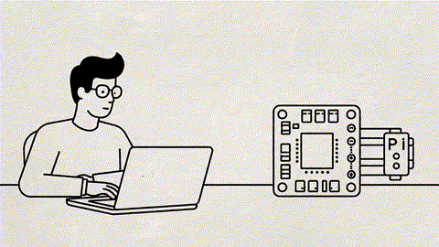
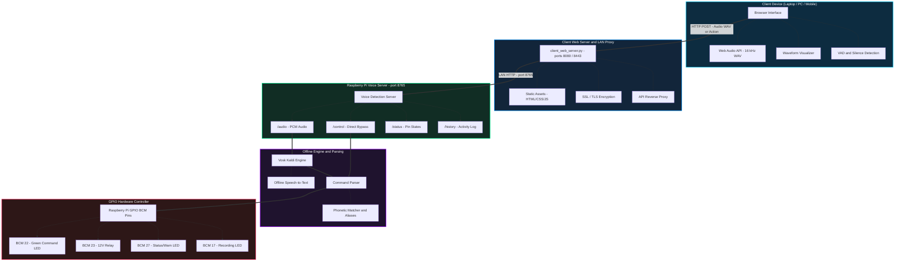
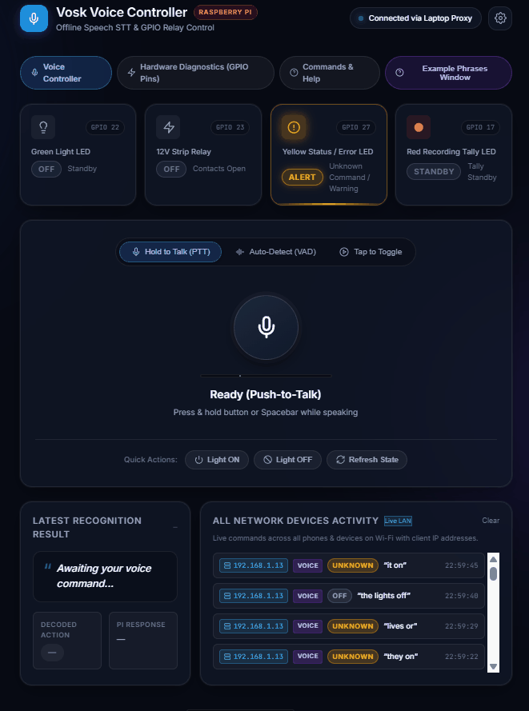
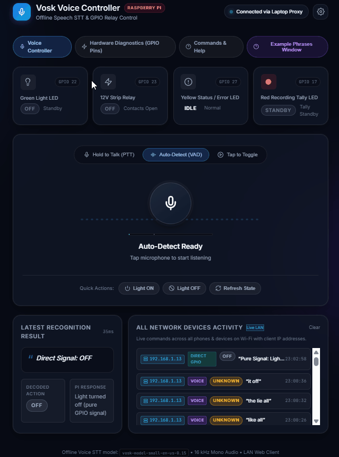
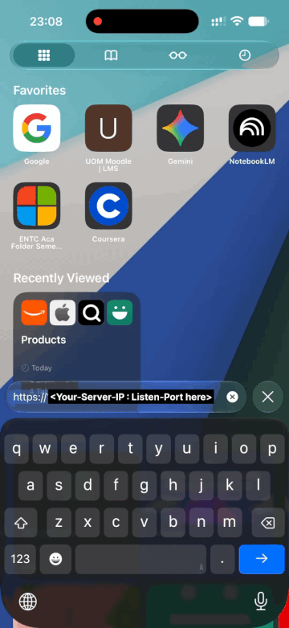
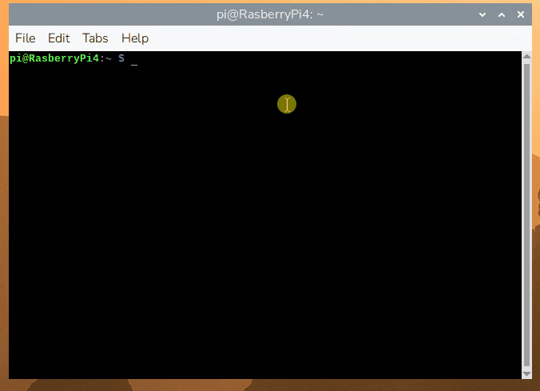
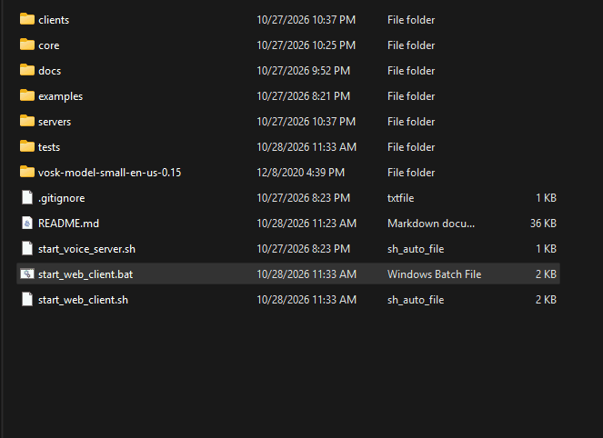
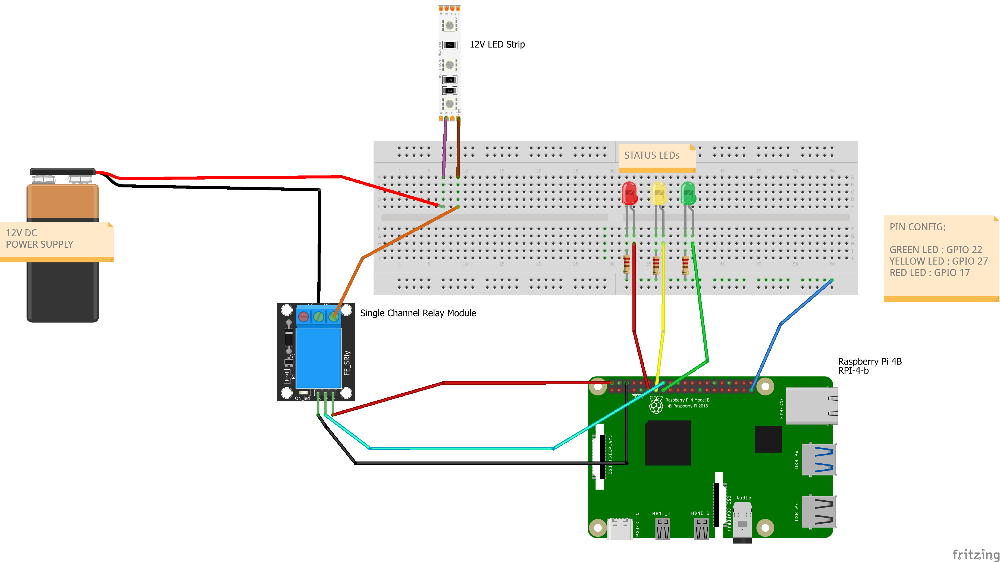
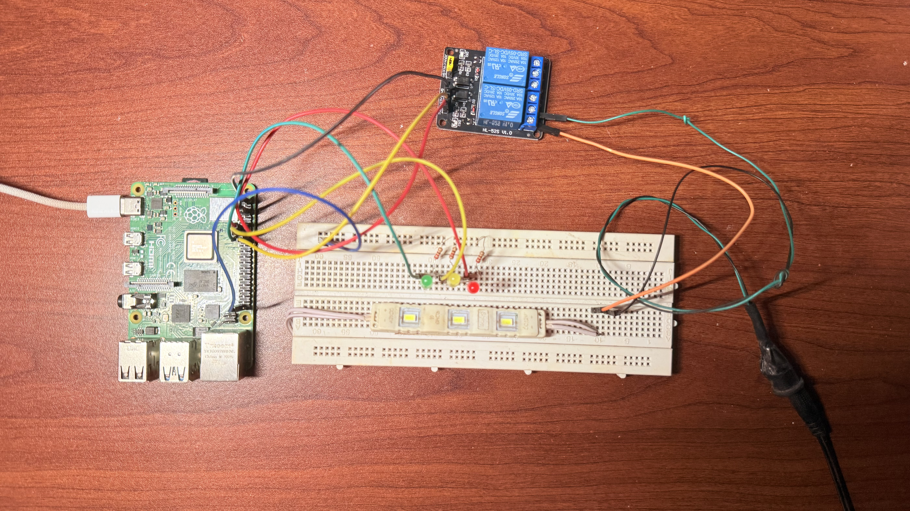

# 🎙️ Offline Voice-Controlled Light & Appliance System for Raspberry Pi

<p align="center">
  
  
  
  
  
</p>

A secure, high-performance, and **100% offline** voice-controlled smart lighting and appliance controller powered by a Raspberry Pi and [Vosk](https://alphacephei.com/vosk/) Kaldi speech recognition. Control status LEDs and a 12V DC light strip (or AC appliance) via a relay using spoken voice commands or an ultra-sleek, responsive glassmorphic web dashboard.

No external cloud APIs, no subscriptions, and zero audio ever leaves your private local network.

---

<div align="center">
  <a href="docs/images/demo_hero.gif">
    
  </a>
  <p>
    <em>🎥 End-to-end voice control: speak a command in the web interface, watch the audio waveform react, and see the Raspberry Pi relay and green LED switch on.</em>
  </p>
</div>

---

## 📑 Table of Contents

- [Key Features](#-key-features)
- [System Architecture](#-system-architecture)
- [Web Client Interface Tour](#-web-client-interface-tour)
- [Raspberry Pi Voice Server](#-raspberry-pi-voice-server)
- [Windows Web Server Launcher](#-windows-web-server-launcher)
- [Hardware Wiring & Circuit Diagram](#-hardware-wiring--circuit-diagram)
- [Hardware Setup](#-hardware-setup)
- [Voice Commands & Phonetic Matcher](#-voice-commands--phonetic-matcher)
- [Software Prerequisites & Installation](#-software-prerequisites--installation)
- [Dynamic Vosk Model Auto-Discovery](#-dynamic-vosk-model-auto-discovery)
- [Quick Start Guide](#-quick-start-guide)
  - [1. Launch Raspberry Pi Voice Server](#1-start-the-voice-detection-server-raspberry-pi)
  - [2. Launch Client Web Server](#2-start-the-client-web-server-laptop--pc--phone)
  - [3. Accessing from Mobile Phones (HTTPS)](#3-mobile-phone-access-over-wi-fi-https)
  - [4. Mock Development Mode](#4-mock-development-mode-no-pi-required)
- [Testing & Diagnostics Suite](#-testing--diagnostics-suite)
- [Standalone Raspberry Pi USB Microphone Mode](#-standalone-raspberry-pi-usb-microphone-mode)
- [Project Directory Structure](#-project-directory-structure)
- [Troubleshooting & FAQ](#-troubleshooting--faq)
- [Safety & Electrical Guidelines](#-safety--electrical-guidelines)
- [License](#-license)

---

## ✨ Key Features

- **🔒 100% Offline & Private:** Real-time Kaldi speech recognition runs directly on the Raspberry Pi. Zero audio data is transmitted outside your local area network.
- **⚡ Dual-Server Distributed Architecture:**
  - **Raspberry Pi Voice Detection Server:** Handles speech transcription, phonetic synonym matching, GPIO relay/LED logic, and unified multi-client activity logging.
  - **Client Web Server & LAN Reverse Proxy:** Hosts an ultra-modern glassmorphic web dashboard, records 16 kHz Mono WAV audio via Web Audio API, and reverse-proxies requests seamlessly.
- **🧭 Dynamic Model Auto-Discovery:** Intelligent model path resolver (`core/model_resolver.py`) automatically discovers the Vosk Kaldi model in project, parent, or home folders without hardcoded paths.
- **🎨 Modern Glassmorphic Web Client:**
  - **Push-to-Talk & Spacebar Trigger:** Hold the microphone button or press `[Space]` to record.
  - **Hands-Free Auto-Detect:** One-tap listening mode with intelligent Voice Activity Detection (VAD) and auto-silence cutoff.
  - **Live Audio Waveform Visualizer:** Real-time canvas audio visualization responding dynamically to voice amplitude.
  - **Instant GPIO Quick Actions:** Direct hardware bypass buttons (`Light ON` / `Light OFF`) for instantaneous switching without STT latency.
  - **Live Hardware HUD & Multi-Device Activity Log:** Real-time pin state indicators and command history tracking connected client IP addresses.
- **🛠️ Independent Hardware Diagnostics Suite:** Built-in `/diagnostics.html` page enabling individual pin toggles, pulse testing, and master overrides to verify LEDs and relay circuits.
- **📱 Mobile HTTPS Support:** Built-in self-signed SSL certificate generation (`--ssl`) enabling microphone permissions (`getUserMedia`) across iPhones, iPads, and Android devices on the LAN.
- **🧪 Automated Batch Testing Suite:** Built-in test runner (`tests/test_voice_commands.py`) with automatic mock GPIO fallback on non-Raspberry Pi machines.

---

## 🏛️ System Architecture



### Data & Audio Flow Pipeline

```text
┌────────────────────────────────────────────────────────┐
│      Client Device (Laptop / PC / iPhone / Android)    │
│  - Web Audio API (16 kHz, 16-bit Mono PCM WAV)         │
│  - Live Audio Waveform Canvas Visualizer               │
│  - Push-to-Talk / Hands-Free VAD Silence Detection     │
└───────────────────────────┬────────────────────────────┘
                            │
                            │ HTTP POST (Audio WAV or GPIO Action)
                            ▼
┌────────────────────────────────────────────────────────┐
│     Client Web Server & LAN Proxy (:8080 / :8443)      │
│  - Static Asset Delivery (HTML5 / Vanilla CSS / JS)    │
│  - SSL / TLS Termination for Mobile Mic Permissions   │
│  - API Reverse Proxy (/api/* -> Pi Server)             │
└───────────────────────────┬────────────────────────────┘
                            │
                            │ LAN HTTP (:8765)
                            ▼
┌────────────────────────────────────────────────────────┐
│        Raspberry Pi Voice Detection Server (:8765)     │
│  ├── /audio   -> Receives WAV audio stream             │
│  ├── /control -> Direct GPIO toggle bypass             │
│  ├── /status  -> Live pin state polling                │
│  └── /history -> Multi-client IP activity tracking     │
└─────────────┬──────────────────────────┬───────────────┘
              │                          │
              ▼                          ▼
┌───────────────────────────┐  ┌─────────────────────────┐
│     Vosk Kaldi Engine     │  │   Command Parser &      │
│  - Auto-Discovered Model  │  │   Phonetic Matcher      │
│  - Offline Speech-to-Text │  │  - Synonyms & Aliases   │
└───────────────────────────┘  └─────────────┬───────────┘
                                             │
                                             ▼
                               ┌─────────────────────────┐
                               │  Raspberry Pi Hardware  │
                               │  - BCM 22: Green LED    │
                               │  - BCM 23: 12V Relay    │
                               │  - BCM 27: Yellow LED   │
                               │  - BCM 17: Red Error    │
                               └─────────────────────────┘
```

---

## 🖥️ Web Client Interface Tour

The Client Web Server provides an intuitive, responsive glassmorphism interface with neon glow indicators, smooth micro-animations, and live feedback.

### 1. Main Voice Controller Dashboard (`/index.html`)

<div align="center">
  <a href="docs/images/web_interface_main.gif">
    
  </a>
  <p>
    <em>📸 Main voice controller dashboard with the microphone control, live waveform, hardware status indicators, GPIO quick actions, and activity feed.</em>
  </p>
</div>

- **Audio Waveform Canvas:** Visualizes microphone sound levels in real time using the browser's Web Audio `AnalyserNode`.
- **Flexible Recording Modes:** Toggle between **Push-to-Talk** (click & hold or spacebar) and **Hands-Free Auto-Detect** (records continuously and stops automatically upon detecting silence).
- **Direct GPIO Quick Actions:** `Light ON` and `Light OFF` buttons allow immediate physical control without waiting for speech transcription.
- **Hardware Status HUD:** Live polling lights display the instantaneous state of the Green LED, 12V Relay, Yellow Status LED, and Red Error LED.
- **Multi-Device Activity Feed:** Displays recent commands, recognized speech strings, and client IP addresses.

---

### 2. Hardware Diagnostics Suite (`/diagnostics.html`)

<div align="center">
  <a href="docs/images/web_diagnostics.gif">
    
  </a>
  <p>
    <em>📸 Hardware diagnostics dashboard for testing individual GPIO pins, pulse output, and master on/off controls.</em>
  </p>
</div>

- **Individual Pin Controls:** Test each LED and relay independently without running voice commands.
- **Test Pulse Button:** Sends a brief 500ms flash pulse to any component to verify circuit continuity.
- **Master Overrides:** One-click `Turn All ON` and `Turn All OFF` buttons for rapid bench testing.

---

### 3. Mobile Device Interface (Responsive & HTTPS)

<div align="center">
  <a href="docs/images/mobile_interface.gif">
    
  </a>
  <p>
    <em>📱 Responsive web client running over LAN HTTPS with mobile microphone access enabled.</em>
  </p>
</div>

---

## 🍓 Raspberry Pi Voice Server

The backend runs on the Raspberry Pi as a lightweight HTTP micro-service listening on port `8765`. It handles audio transcription, executes phonetic matching, interacts with the GPIO controller, and broadcasts status updates.

<div align="center">
  <a href="docs/images/voice_server_terminal.gif">
    
  </a>
  <p>
    <em>💻 Raspberry Pi voice server terminal showing model discovery, startup, audio processing, speech recognition, command parsing, and GPIO activity.</em>
  </p>
</div>

### REST API Endpoints

| Endpoint | Method | Payload / Parameters | Description |
|---|---|---|---|
| `/audio` | `POST` | Raw 16 kHz WAV audio file | Transcribes audio via Vosk, parses command, and triggers GPIO actuation. |
| `/control` | `POST` | `{"action": "light_on" \| "light_off" \| "toggle"}` | Bypasses STT to actuate GPIO relay and Green LED instantly. |
| `/status` | `GET` | _None_ | Returns real-time JSON state of all pins (`light`, `relay`, `yellow`, `red`). |
| `/history` | `GET` | `?limit=20` | Returns recent command execution log including timestamp and client IP. |

---

## 🪟 Windows Web Server Launcher

The [`start_web_client.bat`](start_web_client.bat) file provides a simple Windows launcher for the Client Web Server. Double-click it to choose how the web client should run, without needing to type the full Python command manually.

The launcher supports three modes:

- **HTTP mode:** Starts the web client on port `8080` and connects to the Raspberry Pi voice server at the hostname or IP address you provide.
- **HTTPS mode:** Starts the web client on port `8443` with the local self-signed certificate, enabling microphone access from mobile browsers on the same LAN.
- **Mock mode:** Starts the web client with a simulated Raspberry Pi backend so the interface and controls can be tested without physical hardware.

You can also pass arguments directly from a Command Prompt:

```bat
start_web_client.bat --pi http://<RASPBERRY_PI_IP>:8765
start_web_client.bat --pi http://<RASPBERRY_PI_IP>:8765 --ssl
start_web_client.bat --mock-pi
```

<div align="center">
  <a href="docs/images/web_client_server.gif">
    
  </a>
  <p>
    <em>🎬 Launching <code>start_web_client.bat</code>, selecting a server mode, connecting to the Raspberry Pi, and using the web client controls.</em>
  </p>
</div>

---

## 🔌 Hardware Wiring & Circuit Diagram

The Raspberry Pi drives three status LEDs and an optocoupled relay module configured to control an external 12V DC power circuit.

<div align="center">
  <a href="docs/images/circuit_wiring_diagram.png">
    
  </a>
  <p>
    <em>⚡ Circuit wiring diagram showing the Raspberry Pi GPIO connections, status LEDs, relay module, external 12V supply, and light strip.</em>
  </p>
</div>

---

## 🧰 Hardware Setup

The complete hardware setup used for this project is shown below, including the Raspberry Pi, relay module, status LEDs, resistors, wiring, power supply, and connected light source.

<div align="center">
  <a href="docs/images/hardware_setup_photo.png">
    
  </a>
  <p>
    <em>📷 Complete hardware setup for the Raspberry Pi voice-controlled light and appliance system.</em>
  </p>
</div>

---

### GPIO Pinout Reference Table

All GPIO pin references use standard Broadcom (BCM) numbering:

| Component | BCM Pin | Physical Pin | Recommended Wiring | Functional Purpose |
|---|---|---|---|---|
| 🟢 **Green Command LED** | `GPIO 22` | Pin 15 | In series with a 220Ω – 330Ω resistor to GND | **Dynamic Recognition Burst:** Multi-blinks on valid command confirmation, then settles to target state |
| ⚡ **12V Relay Module** | `GPIO 23` | Pin 16 | Signal (IN) pin; VCC to 5V (Pin 2/4), GND to Pin 6 | Switches external 12V DC power to LED strip |
| 🟡 **Yellow Status / Error LED** | `GPIO 27` | Pin 13 | In series with a 220Ω – 330Ω resistor to GND | **Dynamic Dual-Response:** Breathing fade on unknown speech; rapid warning strobe on system/audio errors |
| 🔴 **Red Recording Tally LED** | `GPIO 17` | Pin 11 | In series with a 220Ω – 330Ω resistor to GND | **Recording Tally Indicator:** Rhythmic studio pulse/blink while recording or sending audio |
| ⏚ **Common Ground (GND)** | `GND` | Pin 6, 9, 14, 20, 25 | Connected to breadboard negative ground rail | Shared ground reference for all LEDs and relay |

> [!IMPORTANT]
> **Electrical Safety Notice:**
> - **Never connect 12V directly to any Raspberry Pi pin!** Raspberry Pi GPIO operates strictly at **3.3V logic** (5V tolerant power rails only on dedicated pins).
> - Always power the 12V LED strip from an **isolated external 12V DC power supply**. Connect the external power supply positive lead through the relay's **Common (COM)** and **Normally Open (NO)** terminals.
> - Ensure your relay module includes an optocoupler and flyback diode protection to suppress inductive kickback.

---

## 🗣️ Voice Commands & Phonetic Matcher

The command parser (`core/command_parser.py`) normalizes speech strings and evaluates spoken phrases using a resilient phonetic synonym matcher:

| Target Action | Recognized Spoken Phrases & Aliases | Hardware Reaction |
|---|---|---|
| **Turn ON** | `"light on"`, `"lights on"`, `"turn on"`, `"turn on the light"`, `"turn on the lights"`, `"turn the light on"`, `"turn on light"`, `"switch on"`, `"activate"`, `"lamp on"` | 🟢 Green LED Dynamic Burst &rarr; ON<br>⚡ Relay ON (12V strip energizes) |
| **Turn OFF** | `"light off"`, `"lights off"`, `"turn off"`, `"turn off the light"`, `"turn off the lights"`, `"turn the light off"`, `"turn off light"`, `"switch off"`, `"deactivate"`, `"lamp off"` | 🟢 Green LED Dynamic Burst &rarr; OFF<br>⚡ Relay OFF (12V strip powers down) |
| **Unknown Speech** | Any audible spoken phrase not matching above (e.g., `"hello"`, `"what is the weather"`) | 🟡 Yellow Status LED executes a soft breathing fade |
| **Audio / Engine Error** | Empty audio stream, corrupted WAV header, or transcription failure | 🟡 Yellow Status LED flashes rapid warning strobe (rerouted from Red) |
| **Recording in Progress** | Microphone active, push-to-talk held, or audio payload uploading | 🔴 Red Recording Tally LED actively blinks like a studio recording button |

---

## 📦 Software Prerequisites & Installation

### 1. Raspberry Pi Setup

- **Operating System:** Raspberry Pi OS (Bullseye, Bookworm, or later).
- **Python:** Version 3.9 or higher.

Install required system and Python dependencies:

```bash
# Update package indices
sudo apt update && sudo apt install -y python3-pip python3-venv git

# Clone repository
git clone https://github.com/saveenmanitha/Vosk_Project.git
cd Vosk_Project

# Install Python packages
pip3 install vosk gpiozero
```

### 2. Client Machine Setup (Laptop / PC / Mac)

- **Python:** Version 3.9 or higher (standard library is sufficient for `client_web_server.py`).
- **OpenSSL:** *(Optional)* Used for automatically generating self-signed HTTPS certificates when running with `--ssl`.

---

## 🧠 Dynamic Vosk Model Auto-Discovery

Traditional scripts often break when repositories are cloned into different user directories due to hardcoded model paths. 

This project includes an intelligent path discovery module (`core/model_resolver.py`):
1. **Repository Root:** Automatically searches for `vosk-model-small-en-us-0.15` (or any `vosk-model*` directory) inside the project folder.
2. **User Home Directory:** Checks `~/vosk-model*` or parent directories.
3. **Environment Variable:** Checks `VOSK_MODEL_PATH` if defined.
4. **Command-Line Override:** You can always specify an explicit path via `--model /custom/path`.

### Downloading the Vosk Model (If Not Included)

If the lightweight English model (`~40 MB`) is not already in your cloned folder:

```bash
wget https://alphacephei.com/vosk/models/vosk-model-small-en-us-0.15.zip
unzip vosk-model-small-en-us-0.15.zip
rm vosk-model-small-en-us-0.15.zip
```

The dynamic resolver detects it immediately upon launch.

---

## 🚀 Quick Start Guide

### 1. Start the Voice Detection Server (Raspberry Pi)

SSH into your Raspberry Pi and start the voice server:

```bash
cd Vosk_Project
bash ./start_voice_server.sh
```

Or execute directly with Python:

```bash
python3 servers/voice_detection_server.py
```

The server automatically loads the Vosk model and begins listening on `http://0.0.0.0:8765`.

#### Optional Server CLI Flags:
```bash
python3 servers/voice_detection_server.py \
  --port 8765 \
  --light-pin 22 \
  --relay-pin 23 \
  --yellow-pin 27 \
  --red-pin 17 \
  --active-low    # Use if your relay module energizes on active-low logic
```

---

### 2. Start the Client Web Server (Laptop / PC / Phone)

Launch the web client on your computer or the Raspberry Pi itself:

#### 🪟 Windows:
Double-click `start_web_client.bat` or run:
```cmd
.\start_web_client.bat
```

#### 🐧 Linux / macOS:
```bash
chmod +x ./start_web_client.sh
./start_web_client.sh
```

#### 🐍 Python CLI:
```bash
# Standard HTTP (port 8080):
python clients/client_web_server.py --pi http://<RASPBERRY_PI_IP>:8765

# Custom web port:
python clients/client_web_server.py --port 9000 --pi http://<RASPBERRY_PI_IP>:8765
```

---

### 3. Mobile Phone Access over Wi-Fi (HTTPS)

Modern mobile browsers (iOS Safari, Android Chrome) **block microphone access** on non-localhost IP addresses unless served over a secure **HTTPS** connection.

Run the client server with the `--ssl` flag:

```bash
python clients/client_web_server.py --pi http://<RASPBERRY_PI_IP>:8765 --ssl
```

1. The server automatically generates a local self-signed certificate in `certs/` and listens on port `8443`.
2. On your smartphone, navigate to: `https://<YOUR_COMPUTER_IP>:8443`
3. Accept the browser's one-time local self-signed certificate notice.
4. Tap the microphone button &mdash; mobile voice recording works instantly!

---

### 4. Mock Development Mode (No Pi Required)

Want to test or customize the web dashboard and pin diagnostics without a physical Raspberry Pi connected?

```bash
python clients/client_web_server.py --mock-pi
```

Starts an internal simulated Raspberry Pi backend on port `8080` that realistically mocks pin states, speech recognition responses, and activity history.

---

## 🧪 Testing & Diagnostics Suite

### 1. Automated Audio Test Suite

The repository includes pre-recorded test audio samples in `audio/`:
- `light_on.wav`, `lights_on.wav`, `turn_on.wav` &rarr; Activates Green LED & Relay.
- `light_off.wav`, `lights_off.wav`, `turn_off.wav` &rarr; Deactivates Green LED & Relay.
- `hello_unknown.wav` &rarr; Triggers Yellow Status LED warning.

Run the test suite against the local Vosk model:

```bash
# Test all audio files in sequence:
python tests/test_voice_commands.py

# Test an individual WAV file:
python tests/test_voice_commands.py audio/turn_on.wav

# Specify custom hold delay:
python tests/test_voice_commands.py --hold-delay 0.5
```

> [!NOTE]
> When executed on a non-Raspberry Pi system (such as Windows or macOS) without `gpiozero`, the test suite automatically engages simulated hardware mode so you can verify speech recognition without errors!

---

## 🎙️ Standalone Raspberry Pi USB Microphone Mode

If you prefer to plug a USB microphone directly into your Raspberry Pi and run local voice control without any web server or network connection:

```bash
# Install audio recording library
pip3 install sounddevice

# Run standalone microphone controller
python3 examples/standalone_mic_control.py
```

This runs a continuous offline listening loop directly on the Pi hardware.

---

## 📂 Project Directory Structure

```text
Vosk_Project/
├── audio/                             # Sample WAV recordings for automated testing
│   ├── hello_unknown.wav              # Non-command speech -> Yellow Status LED
│   ├── light_off.wav                  # "light off" -> Deactivate
│   ├── light_on.wav                   # "light on" -> Activate
│   ├── lights_off.wav                 # "the lights off" -> Deactivate
│   ├── lights_on.wav                  # "lights on" -> Activate
│   ├── turn_off.wav                   # "turn off" (phonetic alias) -> Deactivate
│   └── turn_on.wav                    # "turn on" (phonetic alias) -> Activate
├── certs/                             # Local SSL certificates for mobile HTTPS
│   ├── cert.pem
│   └── key.pem
├── clients/                           # Client web server and web assets
│   ├── __init__.py
│   ├── client_web_server.py           # Web server, reverse proxy, and mock mode
│   └── web/                           # Front-end UI assets
│       ├── app.js                     # Web Audio recorder, VAD, and UI logic
│       ├── diagnostics.html           # Hardware diagnostics interface
│       ├── diagnostics.js             # Diagnostics controller
│       ├── help.html                  # Commands and setup reference
│       ├── index.html                 # Main voice controller dashboard
│       └── styles.css                 # Glassmorphic dark theme
├── core/                              # Shared core backend modules
│   ├── __init__.py
│   ├── command_parser.py              # Spoken phrase matcher and phonetic aliases
│   ├── model_resolver.py              # Dynamic Vosk model auto-discovery
│   ├── relay.py                       # Hardware relay abstraction
│   └── transcriber.py                 # Vosk speech transcription engine
├── docs/                              # Project documentation assets
│   └── images/                        # Screenshots, wiring diagrams, and demo GIFs
│       └── .gitkeep
├── examples/                          # Standalone offline scripts
│   ├── __init__.py
│   └── standalone_mic_control.py       # Direct USB mic listening on Raspberry Pi
├── servers/                           # Backend server microservices
│   ├── __init__.py
│   └── voice_detection_server.py       # Voice detection and GPIO control server
├── tests/                             # Test runners and automated verification
│   ├── __init__.py
│   └── test_voice_commands.py         # Batch audio test runner with mock GPIO
├── vosk-model-small-en-us-0.15/       # Offline Vosk English acoustic model
├── .gitignore                         # Git ignore definitions
├── README.md                          # Comprehensive project documentation
├── start_voice_server.sh              # Raspberry Pi server launcher script
├── start_web_client.bat               # Windows client launcher script
└── start_web_client.sh                # Linux/macOS client launcher script
```

---

## ❓ Troubleshooting & FAQ

### 1. Browser says "Microphone Permission Denied" on Mobile Phone
- **Cause:** Web browsers restrict microphone access (`navigator.mediaDevices.getUserMedia`) to `localhost` or secure contexts (`https://`).
- **Solution:** Start the client server with `--ssl` flag (`python clients/client_web_server.py --pi http://<PI_IP>:8765 --ssl`) and access via `https://<PC_IP>:8443`.

### 2. Client Web Server Cannot Reach the Raspberry Pi (`Connection Refused`)
- **Cause:** The Raspberry Pi IP address has changed or the voice server is not running.
- **Solution:** 
  1. Verify the Pi's IP on your network by running `hostname -I` on the Pi.
  2. Confirm the server is active: `curl http://<PI_IP>:8765/status`.
  3. Ensure both the client device and Raspberry Pi are on the same Wi-Fi subnet / LAN.

### 3. Relay Logic is Inverted (Turns OFF when commanded ON)
- **Cause:** Some relay modules operate on **active-low** logic (trigger on 0V) rather than active-high.
- **Solution:** Start the voice server with the `--active-low` flag:
  ```bash
  python3 servers/voice_detection_server.py --active-low
  ```

### 4. Speech Recognition Accuracy is Low
- **Microphone Placement:** Speak clearly within 15–30 cm of your microphone.
- **Background Noise:** Use the Push-to-Talk mode to minimize ambient sound pickup.
- **Alternative Vosk Models:** For higher accuracy (requiring ~1 GB RAM), you can download the larger `vosk-model-en-us-0.22` model and place it in the project root.

---

## ⚡ Safety & Electrical Guidelines

1. **Low-Voltage Isolation:** Always power external loads (such as 12V LED strips, solenoids, or motors) from an independent, rated power supply. Never attempt to draw 12V from any Raspberry Pi pin.
2. **Current Limiting Resistors:** Always place 220Ω to 330Ω resistors in series with your LEDs to prevent burning out Raspberry Pi GPIO pins.
3. **Inductive Load Suppression:** If controlling relays, motors, or inductive loads, ensure your relay module has an onboard optocoupler and flyback protection diode to prevent reverse voltage spikes.
4. **Common Ground:** Maintain a common ground connection between the Raspberry Pi and the low-voltage logic side of the relay board.
5. **Power Down Before Modifying:** Always disconnect power to both the Raspberry Pi and the 12V supply before altering any jumper wires on the breadboard.

---

## 📄 License

This project is licensed under the Apache License 2.0. The offline Vosk speech recognition engine and Kaldi acoustic models are provided by [Alpha Cephei](https://alphacephei.com/vosk/) under the Apache 2.0 License.
